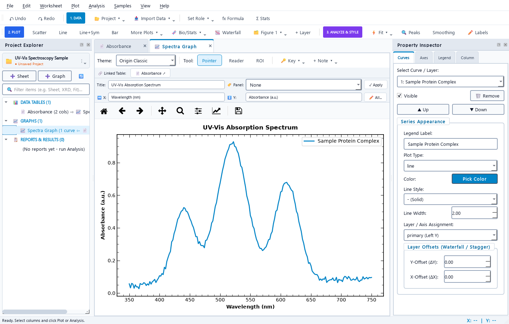

# Graffy

**[Download Graffy for Windows or Mac](https://graffy-scientific-graphing.recentdream1.chatgpt.site)** · No Python or command prompt needed.

**Already have this folder? Open `START HERE.html`, or double-click `Start Graffy.vbs` on Windows.**

After installation, use the Graffy desktop/Start menu shortcut on Windows, or Graffy in Applications on Mac. No terminal or separate Python installation is needed for packaged apps.

Scientific graphing and data analysis for Windows and macOS. Import data, fit curves,
analyze peaks, and export publication-ready figures from one desktop app.

## Download Graffy

**No Python, terminal commands, or GitHub account needed.** Download the app for your computer:

| Computer | Download the latest version |
| --- | --- |
| Windows 64-bit | [**Download for Windows**](https://github.com/MrDotTickles/Graffy/releases/latest/download/Graffy_Windows_Setup.exe) |
| Mac with Apple Silicon (M-series) | [**Download for Mac — Apple Silicon**](https://github.com/MrDotTickles/Graffy/releases/latest/download/Graffy_macOS_arm64.dmg) |
| Mac with an Intel processor | [**Download for Mac — Intel**](https://github.com/MrDotTickles/Graffy/releases/latest/download/Graffy_macOS_x86_64.dmg) |

**Measured Windows build:** about 72 MB to download; about 243 MB of app files after installation.
Python and scientific libraries are included. [Size details](docs/PACKAGE_SIZE.md).

[All releases and portable downloads](https://github.com/MrDotTickles/Graffy/releases/latest)
· [Installation help](docs/INSTALLING.md)
· [Report a problem](https://github.com/MrDotTickles/Graffy/issues)

Use the latest published release. Older tags are retained for history.

**Install:** On Windows, open the installer and follow the steps. On Mac, open the
DMG and drag Graffy into Applications. These builds are currently unsigned, so your
operating system may display a warning or block launch; see the installation guide.
Linux, phones, tablets, and Chromebooks do not currently have supported installers.

## What you can do

- Import CSV and Excel data, edit worksheets, apply formulas, and undo changes.
- Create scatter, line, bar, error-bar, distribution, waterfall, and multi-panel plots.
- Fit linear, polynomial, Gaussian, exponential, Hill dose-response, and other models.
- Find peaks, integrate signals, smooth data, calculate derivatives, and run statistics.
- Style figures with scientific publication themes and export PNG, PDF, SVG, and TIFF.
- Save your workspace as a `.kgraph` project and reopen it later.

## Updates

Graffy checks for updates after opening and every six hours while running. A new
version appears in the update center with release notes and a download button.
You can also use **Help → Check for Updates** or disable automatic checks there.
Save your work and quit Graffy before installing. Windows reuses your installed
location; Mac users replace the app in Applications. Saved project files are separate.

## For the maintainer

**[Start here: upload your changes and publish a release](RELEASING.md).**

Commit changes, double-click `scripts/Release_Graffy.bat`, and enter a new version such as
`1.2.3` if it is higher than your current version. GitHub tests and builds Windows, Apple Silicon Mac, and Intel Mac packages
before publishing a complete release. Keep the repository public for public downloads.

To run from source, install Python 3.13, create a virtual environment, and install
`requirements-dev.txt`. Then use `scripts/Launch_Graffy.bat`, `scripts/Launch_Graffy.command`, or
`python main.py`. App users should use the downloads above.

| Folder | Contents |
| --- | --- |
| `omnigraph/` | Application code and its icons |
| `scripts/` | Build, packaging, release, and developer shortcut tools |
| `packaging/` | Windows installer configuration |
| `docs/` | Install guide, developer handover, and launch validation notes |
| `tests/` | Automated regression tests |
| `.github/workflows/` | GitHub test and release automation |
| `dist/` | Locally built app; excluded from Git |
| `Projects/` | Your saved projects; excluded from Git |

Build/test output, the local Python environment, and personal projects are excluded
from Git. Release dependency versions are recorded in `constraints-release.txt`.

The folder is kept small by removing generated builds and the local Python
environment when not needed. On Windows, `scripts/Setup_Graffy.bat` recreates the environment;
the launch and release buttons run it automatically if missing. Running source
code locally will recreate several hundred megabytes of scientific libraries.

Import files or messy text with **Import data**. Both import routes share local
automatic detection; **Plot → Import data into a graph** adds graph targeting and
a source-text view. [Dialog improvements](docs/IMPORT_AND_DIALOGS.md).

The redesigned desktop workflow and validation notes are documented in [Desktop redesign](docs/DESKTOP_REDESIGN.md). Closing tabs keeps project data intact; reopen items from the project panel.

Chart colors, legend appearance, direct series styling, and contrast improvements: [UI polish](docs/UI_POLISH.md).

Change an existing chart without replotting: [plot switching guide](docs/PLOT_SWITCHING.md).

## License, privacy and security

Graffy is **GPL-3.0-only** open-source software; see [LICENSE](LICENSE) and [third-party notices](THIRD_PARTY_NOTICES.md). Projects and imports are processed locally; update checks contact GitHub. See [privacy information](PRIVACY.md) and [security reporting and release controls](SECURITY.md).

These are unsigned preview builds. Trusted Windows signing, Apple signing/notarization and clean-machine installation/upgrade checks remain launch requirements for a polished general-public rollout. See [launch readiness](docs/LAUNCH_READINESS.md).
